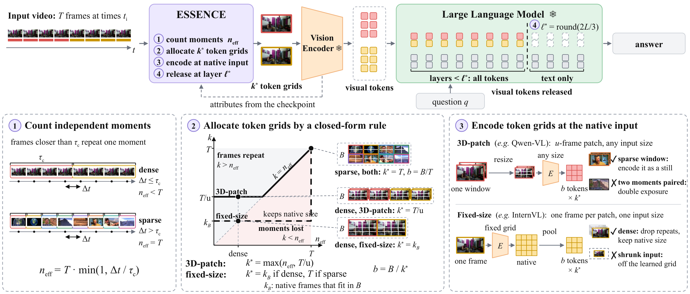
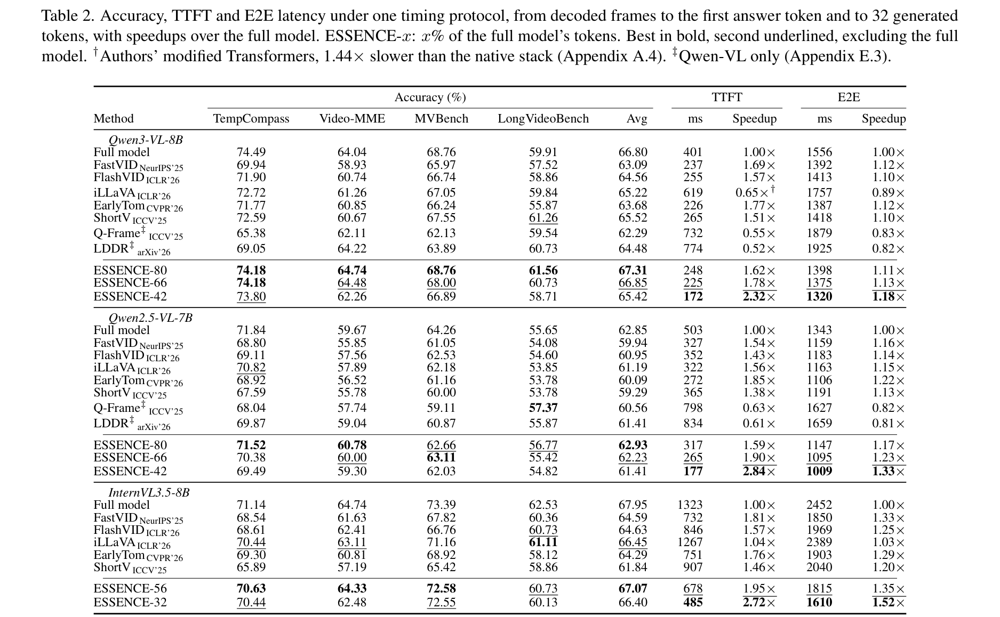
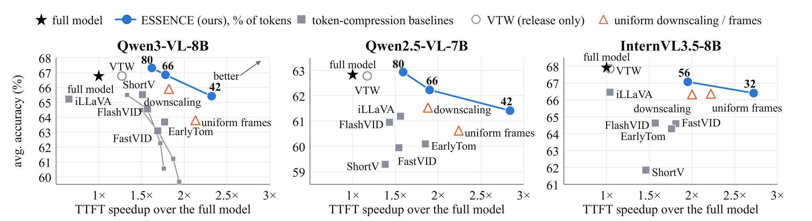
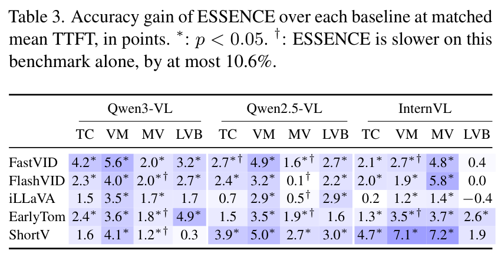

# ESSENCE: Tokenize Moments, Not Frames

Zirui Zhao, [Kai Liu](https://kai-liu.cn/), and [Linghe Kong](https://www.cs.sjtu.edu.cn/~linghe.kong/)

Huazhong University of Science and Technology, Shanghai Jiao Tong University

"Tokenize Moments, Not Frames: Tokenizer-Aware Budget Allocation for Training-Free Video LLM Acceleration", arXiv, 2026

[[arXiv](https://arxiv.org/abs/2611.26933)]

---

## <a name="method"></a> Method

> **Abstract:** Video large language models (LLMs) represent each video with thousands of visual tokens, and training-free accelerators that prune or merge these tokens lose accuracy on long videos. Analyzing frame similarity and the vision tokenizers of 16 open models, we trace this loss to a step before token selection. Under a token budget, the frames of a long video are sampled farther apart than the roughly 2 s over which frames remain similar. The two-frame 3D patches of models such as Qwen-VL then blend two unrelated scenes into each visual token, a *double exposure* that arises before any pruning or merging. Fixed-size tokenizers such as InternVL's avoid this blend but respond differently to the same reduction. We propose ESSENCE, a training-free method that tokenizes *moments*, segments within which frames remain similar, rather than frames. Before encoding, a closed-form rule uses the sampling interval and the tokenizer class to set the number of token grids and the dimension to reduce; visual tokens are then released from later LLM layers. Against five recent accelerators on Qwen3-VL, Qwen2.5-VL and InternVL3.5, ESSENCE achieves higher accuracy in 58 of 60 comparisons at matched mean time to first token (TTFT). With 80% of the tokens, it matches the average accuracy of the full Qwen models at 1.6× faster TTFT; on GLM-4.1V, it exceeds the full model by up to 3.4 points.



---

## <a name="results"></a> Results

<details>
<summary>Click to expand</summary>

- Accuracy, TTFT and end-to-end latency on Qwen3-VL-8B, Qwen2.5-VL-7B and InternVL3.5-8B in Table 2 (main paper)

<p align="center">
  
</p>

- Average accuracy against TTFT speedup in Figure 6 (main paper)

<p align="center">
  
</p>

- Accuracy gain of ESSENCE over each baseline at matched mean TTFT in Table 3 (main paper)

<p align="center">
  
</p>

</details>

## <a name="citation"></a> Citation

If you find this work helpful in your research, please cite the following paper.

```
@article{zhao2026essence,
  title={Tokenize Moments, Not Frames: Tokenizer-Aware Budget Allocation for Training-Free Video LLM Acceleration},
  author={Zhao, Zirui and Liu, Kai and Kong, Linghe},
  journal={arXiv preprint arXiv:2611.26933},
  year={2026}
}
```
